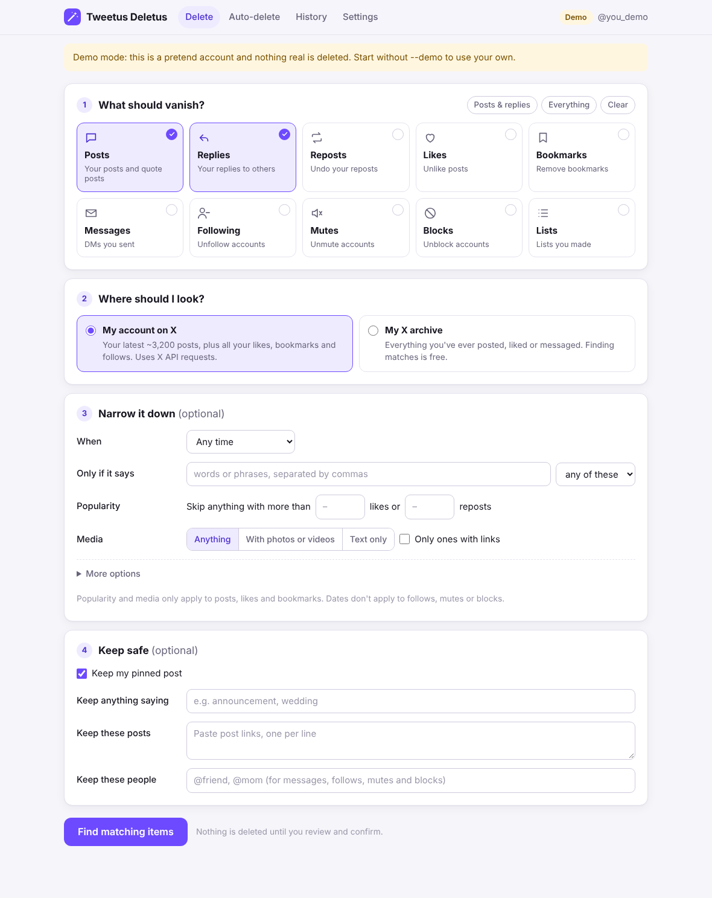
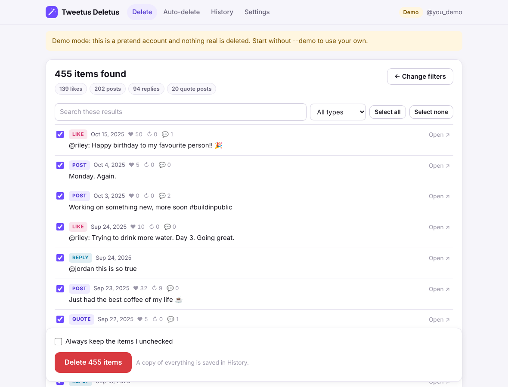

# Tweetus Deletus

Make your X (Twitter) posts vanish. Tweetus Deletus is a small app that runs
on your own computer and deletes your posts, replies, reposts, likes,
bookmarks, messages, follows, mutes, blocks and lists, in bulk and with
filters. It does what Redact does for X, using X's official API and your own
account. Nothing goes anywhere except X.



## Get started

1. **Install Python 3.11 or newer** from <https://www.python.org/downloads/>
   (on Windows, tick “Add python.exe to PATH”). Skip this if you already have it.
2. **Double-click `Start Tweetus Deletus`.** Use the `.command` file on Mac
   and the `.bat` file on Windows. The first launch takes about a minute
   to set up. After that it opens straight away in your browser.
3. **Follow the setup screen.** It walks you through creating a free X
   developer app, pasting its Client ID, and connecting your account. You
   only do this once.

Want to look around first? Double-click **`Try the demo`**. It opens the same
app with a pretend account, so you can try everything without connecting
anything or deleting anything real.

> **Mac says the file “can't be opened”?** Right-click it, choose **Open**,
> then **Open** again. macOS does this for any script downloaded from the
> internet.

Keep the little terminal window open while you use the app. Closing it
quits Tweetus Deletus.

## How it works

### Delete

1. **What should vanish?** Pick any mix of posts, replies, reposts, likes,
   bookmarks, messages, follows, mutes, blocks and lists.
2. **Where should I look?** Choose **My account on X** (your latest ~3,200
   posts, plus all likes, bookmarks and follows) or **My X archive** to
   reach *everything* you've ever posted. To use your archive, drag the
   .zip from X onto the page. Searching your archive uses almost no API
   requests.
3. **Narrow it down** (optional) by date (“older than 30 days”, before a
   date, or between two dates), by words or hashtags, by popularity (skip
   anything with more than N likes), and by media (photos/videos, text
   only, links).
4. **Keep safe** (optional). Keep your pinned post (on by default), anything
   saying certain words, specific posts (paste links), or certain people.
5. Click **Find matching items** and review the list. Uncheck anything you
   want to keep. Tick **Always keep the items I unchecked** to protect
   them for good.
6. Click **Delete** and confirm. Watch the progress bar. You can press
   **Stop** at any time.



### Auto-delete

Turn it on, pick what to clean up (for example posts, replies and reposts)
and an age (for example 30 days). Tweetus Deletus then checks on a schedule
and deletes anything older, while still keeping your pinned post, popular
posts or posts with certain words if you ask it to. It runs while the app is
open, so leave it running on a computer that stays on to keep it going
around the clock.

### History

Every deleted item is saved to a history on your computer, with its text,
date and stats. Search it, or download it as CSV (opens in Excel or Numbers)
or JSON.

### Settings

Reconnect or disconnect your X account, change your app's Client ID, add a
pause between requests, and manage your **always-keep list**: posts that
are never deleted by any search or by auto-delete.

## Getting your X archive

On X, go to **Settings → Your account → Download an archive of your data**.
X emails you when it's ready, which can take a day or so. Download the .zip
and drop it onto the Delete page. Your archive covers posts, replies,
reposts, likes, messages you sent and lists. Bookmarks, follows, mutes and
blocks are always read live from X.

## Costs and limits

- **X charges for API use.** New X developer accounts are on pay-per-use, so
  each request draws on credits you add in the X Developer Portal. Each
  deleted item is about one request (reposts found in an archive take two).
  Reading your account live also uses requests. **Searching your archive
  doesn't**, apart from one quick check of which post is pinned. Check X's
  current prices in the portal before a big clean-up.
- The results page tells you roughly how many requests a delete will use.
  Items already deleted in an earlier run are skipped automatically, so
  re-running an archive search never pays twice.
- X's live timeline only reaches your latest ~3,200 posts. Use your archive
  for anything older.
- Messages: X only lets you delete messages **you sent**, and only from your
  side of the conversation.
- Likes in an X archive have no date, so date filters skip them. Pick
  “Any time” to clean up archived likes, or search your live account.
- If X refuses with “403”, your app probably lacks permission. Set it to
  **Read and write and Direct message** in the portal, then click
  **Reconnect** in Settings. A “402” means your developer account is out of
  credits.
- If X's rate limit is hit, the app waits and carries on by itself and
  shows when it will resume.

## Privacy and safety

- Everything runs on your computer at `http://127.0.0.1:8721`. Only you can
  reach it, and it talks only to X.
- Your sign-in, settings, archive copy and history live in
  `~/.config/tweetus_deletus/` (shown in Settings). Your sign-in file is
  readable only by you.
- Nothing is deleted until you review the list and confirm. Big deletes ask
  you to type DELETE.
- The local server refuses requests from other websites, so a page you
  visit can't trigger deletes behind your back.

## Command line (optional)

Everything is also available from a terminal, for scripting or servers:

```bash
pip install -e .                       # adds the `tweetus-deletus` command
tweetus-deletus                        # open the app (same as the launcher)
tweetus-deletus --demo                 # ...with a pretend account
tweetus-deletus login                  # connect your account without the app
tweetus-deletus preview --what posts --older-than 365
tweetus-deletus delete  --what posts,likes --archive ~/twitter.zip \
    --keep-keyword announcement --log ~/deleted.jsonl
tweetus-deletus watch   --what posts --older-than 30 --interval 6h
```

Run `tweetus-deletus <command> -h` for every option. The command line reads
the same `~/.config/tweetus_deletus/config.toml` that the app's setup screen
writes. See `config.example.toml` if you'd rather write it by hand.

## Development

```bash
python3 tests/test_smoke.py            # filters, archive parsing, deletes
python3 -m unittest tests.test_webui   # the app's server, end to end, offline
```

Code map: `webui.py` (local server) and `ui/` (the page),
`jobs.py` (background scan/delete), `actions.py` (X API calls per content
type), `filters.py`, `archive.py` (X export reader), `auth.py` (OAuth 2.0 with
PKCE), `client.py` (requests and rate limits), `store.py` (history, keep list,
auto-delete rule), `demo.py` (the pretend account), `cli.py`.
