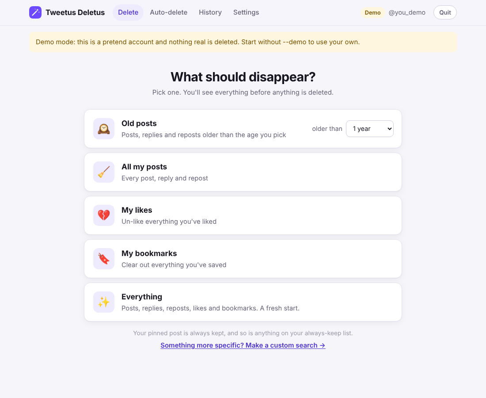

# Tweetus Deletus

Clean up an X (Twitter) account in a few clicks. Delete old posts, replies,
reposts, likes and bookmarks (and, if you want, messages, follows, mutes,
blocks and lists). It's an app that runs on your own computer and talks only
to X.



## Using it

1. **Get the app**: the file someone sent you, or download it:
   - Mac: [Tweetus-Deletus-Mac.zip](https://github.com/juliank103/The-method/releases/latest/download/Tweetus-Deletus-Mac.zip)
   - Windows: [Tweetus-Deletus-Windows.exe](https://github.com/juliank103/The-method/releases/latest/download/Tweetus-Deletus-Windows.exe)
2. **Open it.** It opens in your web browser.
   - *Mac, first time only:* if macOS says it can't be opened, go to
     **System Settings → Privacy & Security**, scroll down, click
     **Open Anyway**, and confirm.
   - *Windows, first time only:* if you see “Windows protected your PC”, click
     **More info → Run anyway**.
3. **Click “Connect with X”**, sign in on X, and approve.
4. **Pick what should disappear**, for example “Old posts older than 1 year”.
5. **Look over the list.** Uncheck anything you want to keep, then click
   **Delete**.

That's it. Your pinned post is always kept, and a copy of everything you
delete is saved in **History**. Click **Quit** (top right) when you're done.


### Other things it can do

- **Auto-delete:** keep only recent posts, e.g. delete anything older than 30
  days, checked every few hours while the app is open.
- **Custom search:** the link under the choices lets you pick exactly what to
  delete by date, words, hashtags, likes, photos or links, and what to keep.
- **Your X archive:** X only lets apps see your latest ~3,200 posts. For older
  ones, request your archive on X (Settings → Your account → Download an
  archive of your data), then add the .zip in a custom search.
- **History:** search everything you've deleted, or download it as a
  spreadsheet.

## One-time setup (for whoever sets it up)

X only allows deleting through its official API, which needs an X developer
app. You create it once, it gets built into the downloads, and from then on
people only ever see **Connect with X**.

1. Go to <https://developer.x.com>, sign in, and create a Project and an App.
   Name the app **Tweetus Deletus**: that's the name shown on X's “approve”
   screen.
2. In the app's **User authentication settings**, click **Set up**:
   - App permissions: **Read and write and Direct message**
   - Type of App: **Native App**
   - Callback URI: `http://127.0.0.1:8721/callback`
   - Website URL: anything, e.g. `https://example.com`
3. Copy the **OAuth 2.0 Client ID**.
4. Make the app with the Client ID built in. Pick one:
   - **On your own computer (simplest).** On a Mac, double-click
     `packaging/Build the Mac app.command`; on Windows, double-click
     `packaging/Build the Windows app.bat`. It needs Python 3.11+ and takes a
     couple of minutes. Paste the Client ID when it asks. The finished app
     appears in the `dist` folder; send her that file (AirDrop, email, USB
     stick).
   - **On GitHub.** In this repo go to **Settings → Secrets and variables →
     Actions → Variables** and add `X_CLIENT_ID` with the Client ID. Then open
     **Actions → Build the app**, pick the latest run and click
     **Re-run all jobs**. When it finishes, the download links above have it
     built in. On a private repo this uses your account's Actions minutes; if
     the run says payments failed or the spending limit needs raising, sort
     that out under **Settings → Billing & plans**, or use the first option.
5. Add credits in the X Developer Portal. X bills API use to your developer
   account (pay-per-use), roughly one request per deleted item.

If this repo is private, the download links only work for people with access,
so download the app yourself and send it over.

*Mac tip:* an app sent by AirDrop or downloaded gets the “can't be opened”
warning the first time. You can clear it for her in Terminal with
`xattr -dr com.apple.quarantine "/Applications/Tweetus Deletus.app"`.

Without a built-in Client ID the app shows a setup screen asking for one
instead, which also works.

## Good to know

- Nothing is deleted until you've seen the list and confirmed.
- X only lets you delete messages *you* sent, and only from your side.
- If X slows things down (rate limits), the app waits and carries on by
  itself.
- If X says “403”, the developer app is missing a permission (step 2 above);
  fix it and click **Reconnect** in Settings. “402” means it's out of credits.
- Everything stays on your computer in `~/.config/tweetus_deletus/`.
- Want to try it without an account? Run it with `--demo` (or open
  `Try the demo` when running from source) for a pretend account.

## Running from source

For developers, or for Macs with an Intel chip (the Mac download is built for
Apple chips): install Python 3.11+, then double-click
`Start Tweetus Deletus.command` (Mac/Linux) or `Start Tweetus Deletus.bat`
(Windows). The first run sets itself up.

Command line, for scripting:

```bash
pip install -e .
tweetus-deletus                          # open the app
tweetus-deletus preview --what posts --older-than 365
tweetus-deletus delete  --what posts,likes --archive ~/twitter.zip --log ~/deleted.jsonl
tweetus-deletus watch   --what posts --older-than 30 --interval 6h
```

Run `tweetus-deletus <command> -h` for every option.

## Development

```bash
python3 tests/test_smoke.py              # filters, archive parsing, deletes
python3 -m unittest tests.test_webui     # the app's server, end to end, offline
pyinstaller --noconfirm packaging/tweetus.spec   # build the double-click app
```

`.github/workflows/build-app.yml` runs the tests, builds the Mac and Windows
apps, checks each one starts, and publishes them as the “Tweetus Deletus”
release. Code map: `webui.py` and `ui/` (the app), `jobs.py` (background
search/delete), `actions.py` (X API calls), `filters.py`, `archive.py`,
`auth.py` (OAuth 2.0 with PKCE), `client.py`, `store.py`, `demo.py`, `cli.py`.
